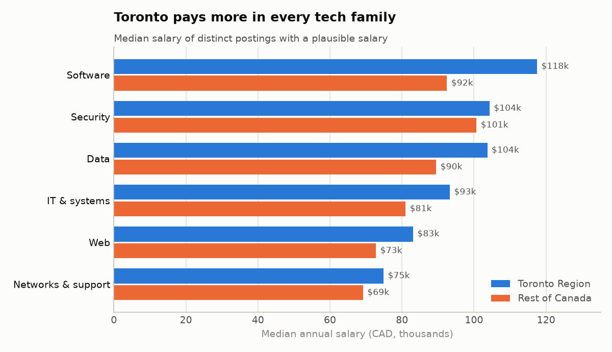
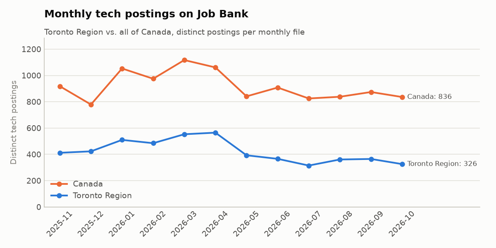

# Toronto Tech Job Market

[](https://github.com/jonahernan99/toronto-tech-job-market/actions/workflows/ci.yml)


**What does the tech job market in Toronto look like in official government data?**
A reproducible SQL analysis of a year of postings from Canada's National Job
Bank: which tech occupations are hiring, what they pay, and how demand changes
month to month.

> **Status: work in progress.** The pipeline and the SQL analysis are done and
> tested. A notebook with charts and a dashboard come next.

## First findings

From the 12 monthly files for November 2025 to October 2026 (601,330 rows,
11,025 distinct tech postings, 5,074 of them in the Toronto Region). The full
tables are in [`reports/summary.md`](reports/summary.md).

1. **Toronto holds about half of Canada's tech postings on Job Bank:** 51% of
   software postings and 55% of data postings are in the Toronto Region.
2. **Toronto pays more in every tech family.** Median annual salary, Toronto
   vs. the rest of Canada:

   

   | Family | Toronto | Rest of Canada |
   | --- | ---: | ---: |
   | Software | $117,500 | $92,500 |
   | Security | $104,300 | $100,700 |
   | Data | $103,700 | $89,500 |
   | IT & systems | $93,300 | $81,000 |
   | Web | $83,100 | $72,800 |
   | Networks & support | $74,900 | $69,200 |

3. **The most advertised Toronto roles** are information systems specialists
   (1,381 postings), software developers (909), software engineers (621) and
   data scientists (421).
4. **Toronto's share dropped in the second half of the period,** from about
   50% between December and April to 38–43% between June and October. One
   year of data cannot tell a seasonal pattern from a trend.

   
5. **Most postings ask for a degree and some experience.** Of the Toronto tech
   postings that state requirements, half ask for a bachelor's degree and
   48% ask for 1 to 3 years of experience.

These figures describe Job Bank, not the whole market (see
[Limitations](#limitations)). Salary ranges for some occupations are narrow,
which may reflect employers who must advertise on Job Bank, for example when
applying to hire through federal programs.

## How the numbers are counted

- **Rows vs. distinct postings.** Job Bank lists one row per work location, so
  14% of rows repeat an ad in another city. Analyses count distinct postings,
  matched by title, occupation, date, salary and terms. The data has no
  employer name, so identical ads from different employers would merge too.
- **Plausible salaries only.** Some postings enter an hourly rate as a yearly
  salary or the reverse. Salaries whose implied hourly rate falls outside $12
  to $250 are excluded from salary statistics (0.4% of hourly and 1.3% of
  yearly salaries).
- **Medians, not averages,** with each posting counted once per region.

Tech means one of [15 NOC 2021 occupations](src/jobmarket/occupations.py),
from software developers and data scientists to user support technicians.

## Pipeline

```text
open.canada.ca CKAN API ──> jobmarket download ──> data/raw/YYYY-MM.csv
                                                        │
                    jobmarket build (DuckDB) <──────────┘
                            │
                            ├── raw_postings   all columns, headers normalized
                            ├── occupations    tech occupation reference table
                            └── postings       typed, cleaned SQL view
```

```bash
pip install -e ".[charts]"
jobmarket download --last 12      # about 0.5 GB of CSV files
jobmarket build                   # creates data/jobmarket.duckdb
jobmarket report                  # SQL analysis + charts in reports/ (needs the charts extra)
```

Then query it with any DuckDB client:

```sql
select occupation_family, count(*) as postings, median(annual_salary) as median_salary
from postings
where is_tech and is_toronto
group by occupation_family
order by postings desc;
```

## Data quality issues handled

Real government data is messy. The pipeline deals with:

- **Unusual encoding:** files are UTF-16, tab-separated text, not standard CSV.
- **Columns change over time:** "Official Language" exists in recent months
  only, so files are combined by column name, not position.
- **Inconsistent headers:** one column is spelled `Economic  Region`, with two
  spaces.
- **Irregular file names** (`oct2026`, `sept2026`, `july2026`): months are found
  through the CKAN API instead of guessing URLs.
- **Missing values** written as `NA`, converted to SQL `NULL`.
- **Salaries in six units** (hour, day, week, bi-weekly, month, year),
  converted to an annual figure. Hourly pay uses the posting's weekly hours, or
  40 hours when none are given. The rules are documented in
  [`staging.sql`](src/jobmarket/sql/staging.sql).
- **Occupation filters:** a code prefix such as `212` would also match
  architects and urban planners, so tech occupations are listed explicitly.

## Limitations

- **Job Bank is not the whole market.** Many tech employers post mainly on
  LinkedIn and their own career sites, so this data shows the market as seen
  on Job Bank and likely under-represents large tech companies.
- **No job descriptions.** The open data has titles and occupation codes but
  no description text, so skills cannot be extracted from it.
- **Telework is not usable:** the field is either "No" or missing in every row.
  The same goes for "Various Location", which is "No" everywhere.
- **Overlapping education labels:** "College/CEGEP" appears alongside longer
  labels for college programs of 3 months to 1 year and of 1 to 2 years, in
  every month. The source does not define how "College/CEGEP" differs from
  them, so the three are kept apart.
- **Requirements are partial:** education and experience are only reported by
  direct employer postings, about a third of all rows.
- **Salary outliers exist** (for example, hourly rates entered as yearly). They
  are flagged with a documented rule and excluded from salary statistics, but a
  wrong salary inside the $12 to $250 hourly range cannot be detected.

## Roadmap

- [x] Download monthly files from the official API
- [x] DuckDB pipeline with a cleaned, typed `postings` view
- [x] Salary outlier rules and posting de-duplication across locations
- [x] SQL analysis: demand by occupation, salaries, education and experience, trends
- [x] `jobmarket report`: Markdown report generated from the SQL queries
- [x] Ordered education and experience levels with short labels
- [x] Charts in the generated report (salaries, monthly trend, education)
- [ ] Notebook with written findings for a non-technical reader
- [ ] Interactive dashboard

## Development

```bash
pip install -e ".[dev]"
ruff check . && ruff format --check .
pytest --cov=jobmarket
```

Tests use small synthetic files in the real format, so they run without
downloading anything.

## Data source and license

Data: [Job Postings Advertised on Canada's National Job Bank Website](https://open.canada.ca/data/en/dataset/ea639e28-c0fc-48bf-b5dd-b8899bd43072),
Employment and Social Development Canada.

Contains information licensed under the
[Open Government Licence – Canada](https://open.canada.ca/en/open-government-licence-canada).

The code in this repository is released under the [MIT License](LICENSE). Raw
data files are not stored in the repository.
