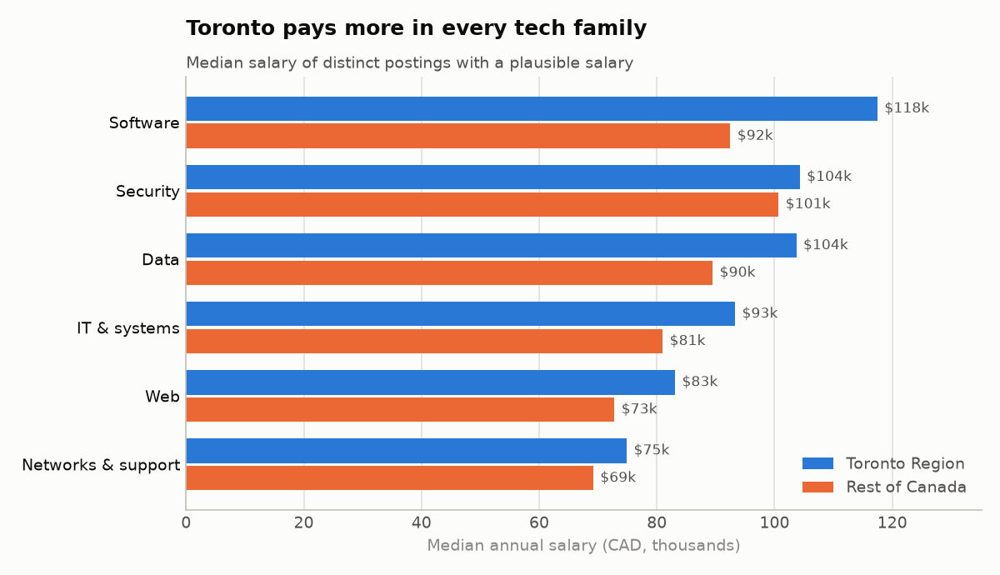
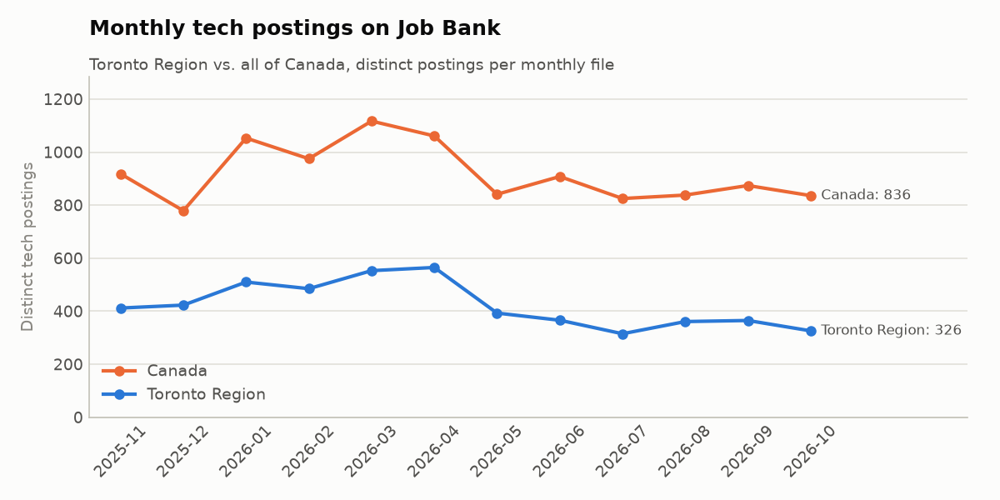
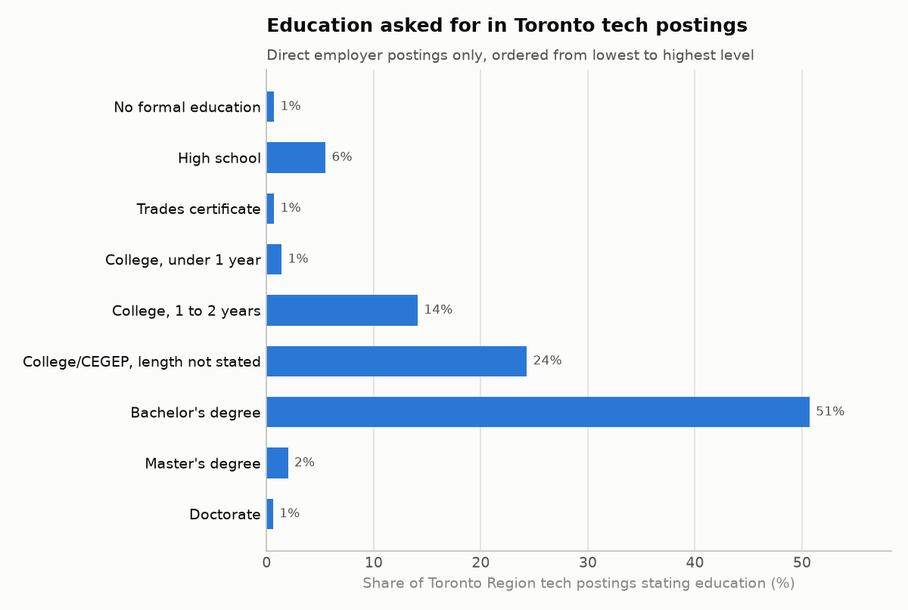
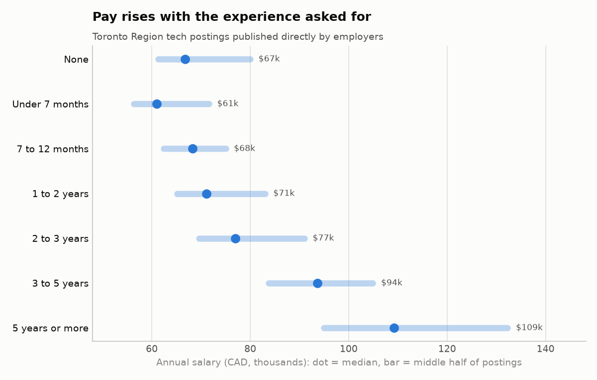
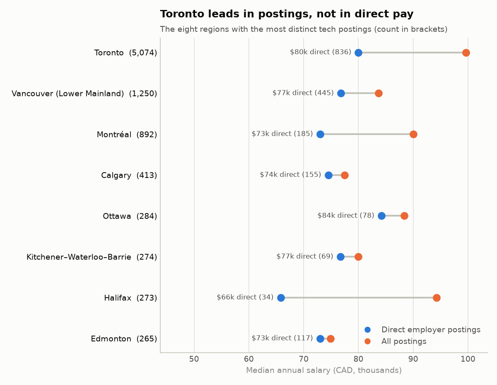

# Toronto Tech Job Market: SQL Analysis Report

Generated on 2026-11-23 by `jobmarket report` from the queries in [`src/jobmarket/sql/analysis`](../src/jobmarket/sql/analysis). Salaries are in CAD.

## Overview

_Rows are postings at one work location; distinct postings merge the same ad repeated in several cities (see posting_key in staging.sql)._

| Months | Rows | Postings | Tech rows | Tech postings | Toronto tech rows | Toronto tech postings |
| ---: | ---: | ---: | ---: | ---: | ---: | ---: |
| 12 | 601,330 | 499,902 | 13,893 | 11,025 | 6,301 | 5,074 |

## Share of Canada's tech postings located in the Toronto Region

_Distinct postings per occupation family. An ad listed in Toronto and in another region counts in both._

| Family | Canada postings | Toronto postings | Toronto share % |
| --- | ---: | ---: | ---: |
| IT & systems | 3,450 | 1,657 | 48.0% |
| Software | 3,142 | 1,596 | 50.8% |
| Networks & support | 1,815 | 534 | 29.4% |
| Data | 1,201 | 655 | 54.5% |
| Web | 866 | 368 | 42.5% |
| Security | 551 | 264 | 47.9% |

## Median annual salary by family, Toronto Region vs. rest of Canada (CAD)

_Plausible salaries only, one row per posting and region so an ad repeated in many cities is not weighted several times. Rounded to the nearest $100._

| Family | Toronto postings | Toronto median | Rest postings | Rest of canada median |
| --- | ---: | ---: | ---: | ---: |
| IT & systems | 1,638 | 93,300 | 1,832 | 81,000 |
| Software | 1,585 | 117,500 | 1,587 | 92,500 |
| Data | 652 | 103,700 | 559 | 89,500 |
| Networks & support | 532 | 74,900 | 1,295 | 69,200 |
| Web | 366 | 83,100 | 508 | 72,800 |
| Security | 264 | 104,300 | 308 | 100,700 |

## Top tech occupations in the Toronto Region

_Distinct postings, with the salary range of those that state a plausible salary (25th, 50th and 75th percentiles, CAD, rounded to $100)._

| Occupation | Postings | With salary | P25 | Median | P75 |
| --- | ---: | ---: | ---: | ---: | ---: |
| Information systems specialists | 1,381 | 1,362 | 60,000 | 92,600 | 115,300 |
| Software developers and programmers | 909 | 899 | 90,000 | 111,200 | 124,800 |
| Software engineers and designers | 621 | 620 | 104,900 | 122,800 | 131,400 |
| Data scientists | 421 | 418 | 98,400 | 103,700 | 108,200 |
| Web developers and programmers | 315 | 313 | 71,900 | 83,200 | 120,000 |
| Business systems specialists | 276 | 276 | 92,600 | 93,300 | 96,900 |
| Cybersecurity specialists | 264 | 264 | 101,900 | 104,300 | 106,200 |
| User support technicians | 206 | 205 | 57,500 | 66,400 | 72,100 |
| Computer network and web technicians | 203 | 202 | 65,500 | 75,000 | 120,000 |
| Database analysts and data administrators | 163 | 163 | 85,700 | 89,500 | 90,400 |

## Monthly tech postings, Toronto Region vs. Canada

_Distinct postings per monthly file._

| Month | Toronto postings | Canada postings | Toronto share % |
| --- | ---: | ---: | ---: |
| 2025-11 | 412 | 918 | 44.9% |
| 2025-12 | 423 | 779 | 54.3% |
| 2026-01 | 510 | 1,053 | 48.4% |
| 2026-02 | 485 | 975 | 49.7% |
| 2026-03 | 553 | 1,117 | 49.5% |
| 2026-04 | 565 | 1,061 | 53.3% |
| 2026-05 | 393 | 841 | 46.7% |
| 2026-06 | 366 | 908 | 40.3% |
| 2026-07 | 315 | 825 | 38.2% |
| 2026-08 | 361 | 838 | 43.1% |
| 2026-09 | 365 | 874 | 41.8% |
| 2026-10 | 326 | 836 | 39.0% |

## Education asked for in Toronto Region tech postings

_Only direct employer postings report education, so external postings are left out of the percentages. Levels are ordered from lowest to highest._

| Education | Postings | Pct |
| --- | ---: | ---: |
| No formal education | 6 | 0.7% |
| High school | 46 | 5.5% |
| Trades certificate | 6 | 0.7% |
| College, under 1 year | 12 | 1.4% |
| College, 1 to 2 years | 118 | 14.1% |
| College/CEGEP, length not stated | 204 | 24.3% |
| Bachelor's degree | 425 | 50.7% |
| Master's degree | 17 | 2.0% |
| Doctorate | 5 | 0.6% |

## Experience asked for in Toronto Region tech postings

_Only direct employer postings report experience, so external postings are left out of the percentages. Levels are ordered from least to most._

| Experience | Postings | Pct |
| --- | ---: | ---: |
| None | 62 | 7.4% |
| Under 7 months | 32 | 3.8% |
| 7 to 12 months | 61 | 7.3% |
| 1 to 2 years | 211 | 25.1% |
| 2 to 3 years | 191 | 22.8% |
| 3 to 5 years | 138 | 16.4% |
| 5 years or more | 144 | 17.2% |

## Salary data quality by pay unit (all postings)

_Rows whose implied hourly rate falls outside $12 to $250 are flagged as implausible and excluded from salary statistics._

| Pay unit | Rows | Implausible | Implausible % |
| --- | ---: | ---: | ---: |
| Hour | 500,046 | 1,838 | 0.4% |
| Year | 85,817 | 1,146 | 1.3% |
| Month | 4,416 | 345 | 7.8% |
| missing | 4,083 | 0 | 0.0% |
| Bi-weekly | 2,508 | 175 | 7.0% |
| Week | 2,253 | 136 | 6.0% |
| Day | 2,207 | 210 | 9.5% |

## Salary by experience asked for, Toronto Region tech postings (CAD)

_Only direct employer postings report experience, so this table covers them alone; their salaries are lower than those of external postings. Plausible salaries, one row per posting, percentiles rounded to the nearest $100._

| Experience | Postings | P25 | Median | P75 |
| --- | ---: | ---: | ---: | ---: |
| None | 62 | 61,300 | 66,800 | 80,000 |
| Under 7 months | 32 | 56,400 | 61,000 | 71,600 |
| 7 to 12 months | 61 | 62,400 | 68,300 | 75,000 |
| 1 to 2 years | 211 | 65,100 | 71,100 | 83,000 |
| 2 to 3 years | 191 | 69,600 | 77,000 | 91,000 |
| 3 to 5 years | 137 | 83,700 | 93,600 | 104,900 |
| 5 years or more | 143 | 95,000 | 109,200 | 132,300 |

## Repeated wide salary ranges in Toronto Region tech postings

_A repeated wide range is a minimum and maximum that differ (for example $30.00 to $69.74 an hour) and appear in at least 20 distinct Toronto tech postings. In this data each one belongs to a single occupation, recurs across months and comes from external job boards, so they look like occupation-wide templates rather than individual offers. Round single values such as $50 an hour also repeat, but across many occupations, and are not counted here. Range midpoints drive the medians of external postings, which is why salaries are also shown for direct employer postings alone (next table)._

| Source | Postings with salary | In repeated ranges | Repeated % |
| --- | ---: | ---: | ---: |
| Direct employer postings | 836 | 0 | 0.0% |
| External job boards | 4,201 | 1,380 | 32.8% |
| All | 5,037 | 1,380 | 27.4% |

## Median annual salary by family, direct employer postings only (CAD)

_The same comparison as the salary table above, restricted to postings that employers publish on Job Bank themselves, where repeated template ranges are rare. Samples are smaller, so read differences of a few thousand dollars with care. Plausible salaries, one row per posting and region, rounded to $100._

| Family | Toronto postings | Toronto median | Rest postings | Rest of canada median |
| --- | ---: | ---: | ---: | ---: |
| Networks & support | 252 | 67,300 | 623 | 65,500 |
| Software | 202 | 95,000 | 430 | 90,000 |
| IT & systems | 166 | 88,100 | 339 | 82,500 |
| Web | 95 | 65,500 | 279 | 68,300 |
| Data | 93 | 90,000 | 167 | 80,000 |
| Security | 29 | 100,400 | 64 | 97,300 |

## Toronto compared with Canada's other tech hubs (CAD)

_The eight economic regions with the most distinct tech postings, chosen by that rule rather than by hand. A posting listed in two regions counts once in each. Salaries are shown for all postings and for direct employer postings alone, because external job boards' repeated template ranges raise the all-postings median. Direct samples outside Toronto are small, so read the counts. Plausible salaries, medians rounded to the nearest $100._

| Region | Province | Postings | Direct % | Median all | Direct salaries | Median direct |
| --- | --- | ---: | ---: | ---: | ---: | ---: |
| Toronto Region | Ontario | 5,074 | 16.5% | 99,600 | 836 | 80,000 |
| Lower Mainland–Southwest Region | British Columbia | 1,250 | 35.6% | 83,700 | 445 | 76,800 |
| Montréal Region | Québec | 892 | 20.7% | 90,000 | 185 | 73,000 |
| Calgary Region | Alberta | 413 | 37.5% | 77,500 | 155 | 74,500 |
| Ottawa Region | Ontario | 284 | 27.5% | 88,400 | 78 | 84,200 |
| Kitchener–Waterloo–Barrie Region | Ontario | 274 | 25.2% | 80,000 | 69 | 76,700 |
| Halifax Region | Nova Scotia | 273 | 12.5% | 94,300 | 34 | 65,800 |
| Edmonton Region | Alberta | 265 | 44.2% | 74,900 | 117 | 73,000 |

---

Contains information licensed under the [Open Government Licence – Canada](https://open.canada.ca/en/open-government-licence-canada). Source: [Job Postings Advertised on Canada's National Job Bank Website](https://open.canada.ca/data/en/dataset/ea639e28-c0fc-48bf-b5dd-b8899bd43072), Employment and Social Development Canada.
